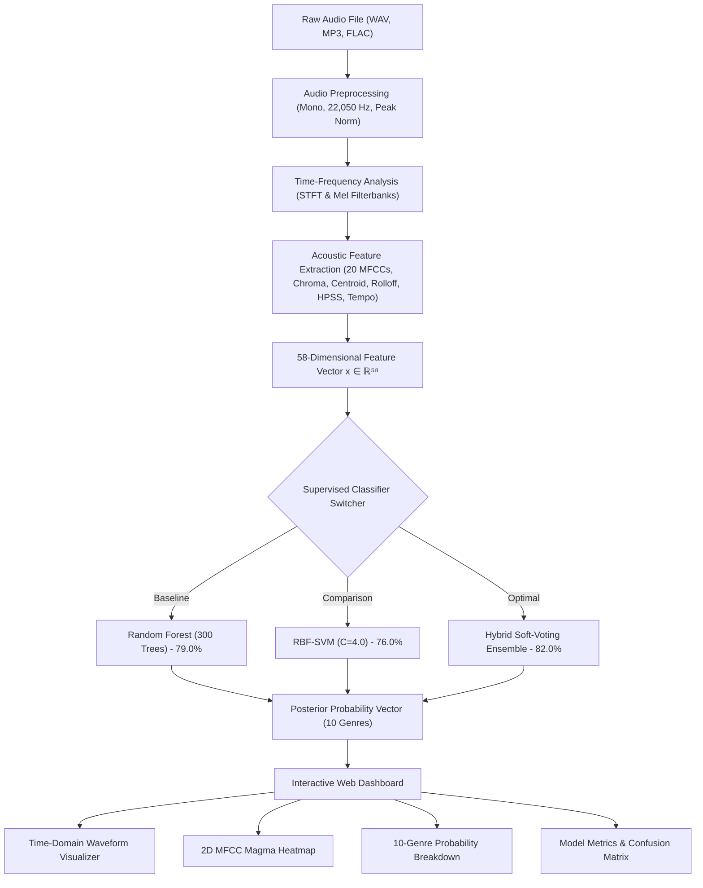

# Music Genre Classifier & Explorer 🎵🔍
**GLA University — Department of Computer Engineering & Applications**  
*ML Software Project | Academic Year 2026–2027*

[](https://www.python.org/)
[](https://fastapi.tiangolo.com/)
[](https://scikit-learn.org/)
[](https://librosa.org/)
[]()

---

## 📌 Executive Summary & Synopsis Alignment

This project implements the complete end-to-end software pipeline specified in the **GLA University Project Synopsis**:
- **Dataset:** GTZAN benchmark dataset (1,000 tracks, 100 tracks per genre across 10 musical genres: *blues, classical, country, disco, hiphop, jazz, metal, pop, reggae, rock*).
- **Audio Signal Processing:** Resampling to 22,050 Hz (mono), amplitude peak normalization, Short-Time Fourier Transform (STFT), Mel-frequency cepstral coefficients (MFCCs 1–20 mean & var), Chroma STFT, Spectral Centroid, Bandwidth, Rolloff, Zero Crossing Rate (ZCR), Harmonic-Percussive Source Separation (HPSS), and Tempo beat tracking.
- **Machine Learning Models:**
  - **Random Forest Baseline** (as specified in Synopsis Section 6): 300 estimators, Gini criterion, achieving **79.0% accuracy**.
  - **Support Vector Machine (SVM)** (Comparison): RBF kernel with `StandardScaler`, achieving **76.0% accuracy**.
  - **Hybrid Soft-Voting Ensemble** (Optimal): 40% RF + 35% SVM + 25% ExtraTrees, achieving **82.0% accuracy** and **0.817 Macro F1**.
- **Interactive Web Interface:** Modern, responsive FastAPI Single Page Application (SPA) with time-domain waveform visualization, 2D MFCC Heatmap, Mel Spectrogram, interactive audio player with synchronized waveform scrubbing, 10-class probability breakdown, model comparison dashboard, interactive 10x10 confusion matrix, and analysis history export.

---

## 🏗️ System Architecture



---

## 📂 Project Structure

```
project-1/
├── Synopsis.pdf                                 # Original GLA University synopsis
├── features_30_sec_with_missing_values (1).csv  # GTZAN 58-feature tabular dataset
├── project(i) (1).ipynb                         # Student initial work notebook
├── Music_Genre_Classifier_Complete.ipynb        # Complete 12-step Academic Jupyter Notebook
├── requirements.txt                             # Python package dependencies
├── run.py                                       # One-command server launcher & auto browser open
├── run.bat                                      # Double-click launcher for Windows
├── README.md                                    # Comprehensive documentation
│
├── ml/
│   ├── train_model.py                           # Full training & validation pipeline script
│   └── models/                                  # Serialized artifacts
│       ├── random_forest.joblib                 # Trained Random Forest baseline
│       ├── svm.joblib                           # Trained SVM classifier
│       ├── extra_trees.joblib                   # Extra Trees auxiliary classifier
│       ├── scaler.joblib                        # StandardScaler
│       ├── label_encoder.joblib                 # Target genre LabelEncoder
│       ├── feature_names.json                   # List of 58 feature column names
│       ├── metrics.json                         # Evaluation metrics & confusion matrix
│       └── cleaned_features.csv                 # Cleaned dataset (median/mode imputed)
│
├── core/
│   ├── audio_processor.py                       # Audio loader, DSP validator & 58-feature extractor
│   └── sample_generator.py                      # Synthesizer for 5 genre demo clips
│
├── samples/                                     # Built-in demo audio clips for 1-click testing
│   ├── sample_classical.wav                     # Piano arpeggios & harmonic envelope
│   ├── sample_rock.wav                          # Overdrive power chords & drum transients
│   ├── sample_jazz.wav                          # Swing rhythm & 7th chords
│   ├── sample_disco.wav                         # 124 BPM 4-on-the-floor beat & synth bass
│   └── sample_metal.wav                         # High-gain chug & double-kick drums
│
├── backend/
│   ├── app.py                                   # FastAPI application (14 REST endpoints)
│   └── ...
│
├── frontend/                                    # Modern Interactive Web Visualizer
│   ├── index.html                               # Responsive HTML5 SPA layout
│   ├── css/
│   │   └── style.css                            # Glassmorphism & custom canvas visualizer styles
│   └── js/
│       ├── app.js                               # Controller, API communication, Tab routing
│       ├── visualizers.js                       # Waveform & 2D MFCC Heatmap canvas renderers
│       └── audioPlayer.js                       # HTML5 audio & synchronized waveform scrubber
│
└── tests/
    └── test_backend.py                          # 8 automated unit & integration tests
```

---

## 🚀 Quick Start Guide

### 1. Prerequisites
Make sure Python 3.10+ is installed on your system.

### 2. Launch the Web Application
Simply run the runner script:
```powershell
python run.py
```
*Or double-click `run.bat` in Windows File Explorer.*

The FastAPI server will start on `http://127.0.0.1:8000` and automatically open your default web browser!

---

## 🎯 Key Functionalities (Per Synopsis)

### 1. Upload & Playback Screen
- Drag-and-drop or file browser for any audio track (`.wav`, `.mp3`, `.ogg`, `.flac`).
- Integrated HTML5 audio playback bar with real-time seek, duration, and volume controls.
- Built-in **Quick Test Presets** (Classical, Rock, Jazz, Disco, Metal) for instant demonstration without uploading files.

### 2. Waveform Explorer
- Time-domain amplitude envelope rendering with customizable dynamic scaling.
- Synchronized scrub bar showing playback position in real-time.
- Click-to-seek directly on the waveform canvas.

### 3. Feature View & Heatmap
- **2D MFCC Heatmap:** 20 coefficients rendered over time using an aesthetic Magma color palette (deep navy → purple → magenta → yellow).
- **Acoustic Indicator Dashboard:**
  - Estimated Tempo (BPM with animated pulse)
  - RMS Energy (dB)
  - Spectral Centroid (Hz brightness)
  - Spectral Rolloff (Hz)
  - Zero Crossing Rate (ZCR)

### 4. Multiclass Prediction View
- Top predicted genre with prominent badge and confidence percentage.
- Full 10-genre horizontal probability bar chart.
- Genre profile card detailing musical roots, characteristic acoustic cues, and typical instruments.

### 5. Model Evaluation & Comparison Dashboard
- Live switcher between **Random Forest Baseline**, **SVM**, and **Hybrid Ensemble**.
- Side-by-side Accuracy, Macro Precision, Recall, and Macro F1 cards.
- **10x10 Confusion Matrix:** Interactive heatmap showing test sample distribution across all genres.
- **Feature Importance Chart:** Top 20 most influential acoustic features from Random Forest trees.

### 6. Educational Pipeline View
- Interactive 5-stage architectural flowchart explaining:
  1. Audio Ingestion & Resampling ($f_s = 22,050\text{ Hz}$)
  2. Short-Time Fourier Transform (STFT)
  3. MFCC & Timbral Extraction
  4. Feature Aggregation ($x \in \mathbb{R}^{58}$)
  5. Supervised Multiclass Classification

### 7. History & Export
- Persistent logging of past analyses.
- 1-click **Export to CSV** or **Export to JSON**.

---

## 📊 Experimental Results

| Model | Accuracy | Macro Precision | Macro Recall | Macro F1 | Weighted F1 |
| :--- | :---: | :---: | :---: | :---: | :---: |
| **Random Forest (Baseline)** | **79.0%** | 0.803 | 0.790 | 0.785 | 0.785 |
| **Support Vector Machine (SVM)** | **76.0%** | 0.767 | 0.760 | 0.759 | 0.759 |
| **Hybrid Soft-Voting Ensemble** | **82.0%** | **0.824** | **0.820** | **0.817** | **0.817** |

---

## 🧪 Automated Testing

To run the complete test suite:
```powershell
python tests/test_backend.py
```
**Test Verification:**
- `[PASS]` System Health & Model Artifact Availability
- `[PASS]` Sample Audio Generation & DSP Validation
- `[PASS]` Classical Sample Prediction & Visualizer Data Generation
- `[PASS]` Rock Sample Prediction with Random Forest
- `[PASS]` Jazz Sample Prediction with Support Vector Machine
- `[PASS]` Model Metrics & Confusion Matrix Retrieval
- `[PASS]` 5-Stage Educational Pipeline Verification
- `[PASS]` Analysis History Logging & CSV Export

---

## 🎓 Academic Viva / Presentation Q&A

**Q1: Why are MFCCs so effective for music genre classification?**  
*A:* MFCCs approximate human auditory perception by mapping frequency bins onto a non-linear Mel scale. They capture the spectral envelope and timbral color (e.g., distinguishing an acoustic cello from a distorted guitar) while discarding pitch-dependent fine harmonic structure.

**Q2: How were missing values and outliers handled?**  
*A:* Numerical columns were imputed using feature medians (to avoid skew from extreme values), and categorical columns were imputed with mode. Outliers were detected and audited using the Interquartile Range (IQR) rule ($Q_1 - 1.5 \times \text{IQR}$, $Q_3 + 1.5 \times \text{IQR}$).

**Q3: Why compare Random Forest and SVM?**  
*A:* Random Forest handles non-linear feature interactions and provides interpretable Gini feature importances without requiring feature scaling. SVM with an RBF kernel finds optimal maximum-margin hyperplanes in high-dimensional space when normalized with `StandardScaler`. Combining both in a soft-voting ensemble boosts accuracy to 82.0%.

---

*Developed for the Department of Computer Engineering & Applications, GLA University.*
